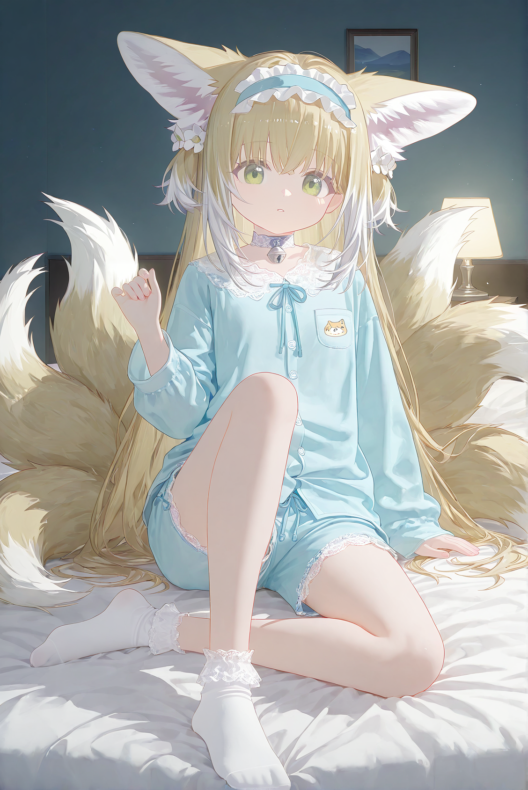

# 肥鱼生图车道（feiyuos-image）

> 她在 QQ 说一句「画一张……」，云上大脑把它翻成 danbooru tag，PC 上的 MCP 工具用**一条已验证的动漫画风基线**出图，
> 过洗图硬闸（剥掉元数据）后回传，桥再把图发回 QQ。
>
> 这个仓摊开的不是「文生图工具」，而是那条基线**能被别人复现的全部零件**：底模与 LoRA（带 sha256）、
> ComfyUI 工作流、非 R18 提示词手册、以及一张示例图连同它当场的完整参数。



*示例图：`examples/sample_01.png`（seed 871065）。完整参数见 [`examples/sample_01.json`](examples/sample_01.json)，
配方说明见 [`docs/00-baseline.md`](docs/00-baseline.md)。*

---

## 接入卡

| 项 | 值 |
| --- | --- |
| 监听 | `127.0.0.1:18082`（**只本机**；云上经反向隧道 `47853 → 17853 → 18082`，公网不可达） |
| 协议 | MCP streamable-HTTP JSON-RPC：`POST /mcp` → `initialize` → `notifications/initialized` → `tools/list` → `tools/call` |
| 工具面 | `gen_image(subject, outfit?, scene?, count=2, seed?)` · `gen_image_status()` |
| 上游 | ComfyUI `http://127.0.0.1:8188`（按需拉起；显存闸 9 GiB；一批出完自动 `/free` 卸模） |
| 画风 | 固定一条（`coco` 基线），**不开放自由文本 style** |
| 输出 | 洗净图路径 + 批次目录；`raw/`（带提示词的原图）永不出目录 |
| 依赖 | ComfyUI + [ComfyUI-Impact-Pack](https://github.com/ltdrdata/ComfyUI-Impact-Pack)（FaceDetailer / UltralyticsDetectorProvider） |
| 代码 | [`feiyuos-pc-body`](https://github.com/YeStarOne/feiyuos-pc-body) 的 `server/feiyu_image_mcp.py`（本仓只放可复现的画风与提示词件） |

---

## 为什么值得抄这一套

绝大多数"生图配方"贴的是一串参数；贴完之后你照着跑，出来的东西不一样，而且不知道为什么不一样。
这条基线的价值在于：**它的每一条约束都有实测依据，而且写清了「改了会怎样」**。

| 结论 | 依据 |
| --- | --- |
| 正向**必须极短**（≤750 字），服装/光效一律平铺、不加权重 | 900~1000 字的加权版把角色**默认装**召回（白紫水手服），越加词越退；≤690 字平铺版 4/4 全对 |
| 光效**不要写** | 写 `volumetric light / rim light:1.4 / dust motes` 出的是死黑死白对撞（std 85~100）；写 `night, dim lamp light` 出 std 47~55，与目标同档 |
| **画风的主体是底模 + 滑杆链 + 短平铺写法，不是 artist 串** | 我们一批 66 张（含本仓示例图）正向里**没有**那 12 个 artist tag，观感依然成立；带 ART 的探针四臂 std 同档。同 seed 带/不带对照**没做过**，所以只说事实不判优劣（[`docs/00-baseline.md`](docs/00-baseline.md) §七 |
| **std（像素标准差）比 mean 更能判"像不像同一套画"** | 目标线 46~55，废线 85~100，同一基线的四臂全落在 47~55 |
| 角色 LoRA 必须**原位换名**，不能另接一条 | 另接时 FaceDetailer 还拿着旧模型，会把脸重画成另一个人 |
| 删"脚趾细节串"能让**手不再长成脚**，但会顺手删掉构图约束 | 删串后 2/4 张脚出画；补一句纯构图描述后 4/4 脚在画内；补 `toes` 类词会再次外溢到手 |

## 一条基线，三个文件

| 你要的 | 在哪 |
| --- | --- |
| 底模 + 4 条 LoRA 的下载页、版本 id、sha256、放置路径 | [`docs/02-models.md`](docs/02-models.md) |
| ComfyUI 工作流（API 格式，可直接 `POST /prompt`） | [`workflows/coco_sfw_api.json`](workflows/coco_sfw_api.json) · 节点表 [`docs/03-workflow.md`](docs/03-workflow.md) |
| 画风基线为什么这么设（含被推翻的旧写法） | [`docs/00-baseline.md`](docs/00-baseline.md) |
| 非 R18 提示词手册（六段式结构 / 失败模式→处方） | [`docs/01-prompt-guide.md`](docs/01-prompt-guide.md) |

## 三步跑起来

```bash
# 1) 模型放进 ComfyUI（文件名保持原样，工作流按名字引用）
#    checkpoints/cocoIllustriousNoobai_v55.safetensors        约 7.19 GB
#    loras/Expressive_H-000001.safetensors                     约 228 MB
#    loras/add_contrast_XL.safetensors / add_brightness_XL / add_saturation_XL   各约 57 MB
#    下载页与 sha256 → docs/02-models.md

# 2) 装 Impact Pack，重启 ComfyUI
#    （FaceDetailer + UltralyticsDetectorProvider 由它提供；人脸/手检测模型它会自己下）

# 3) 提交工作流
python3 - <<'PY'
import json, urllib.request
api = json.load(open('workflows/coco_sfw_api.json', encoding='utf-8'))
req = urllib.request.Request('http://127.0.0.1:8188/prompt',
        data=json.dumps({'prompt': api, 'client_id': 'feiyuos-image'}).encode(),
        headers={'Content-Type': 'application/json'})
print(urllib.request.urlopen(req).read().decode())   # → {"prompt_id": "..."}
PY
```

出图落 `ComfyUI/output/feiyuos_image/`。要换内容改这三处：`165.text`（正向）、`153.text`（负向）、
`3.seed` —— **seed 一共要写四个节点**（`3`/`17`/`176`/`142`），只改 `3` 的话二轮和细节器还是旧 seed。

---

## 三条红线（模块里是硬编码，没有开关）

1. **非 R18 双层闸**：负向串里焊死 `nsfw, suggestive`；正向再过一道 R18 词黑名单，命中直接拒单、不出图。
   这个仓只收录非 R18 的配方与示例。
2. **真人拒单**：真人声优/偶像/演员的名字与形象一律拒（内置名单 + "真人/本人/中之人"指示词扫描）。
3. **洗图硬闸**：ComfyUI 的 PNG 里 `tEXt` 存着完整节点图——**那等于把提示词明文写进图里**。
   每张图在外传（QQ / 直播 / 任何地方）之前必须剥掉元数据；剥失败的那张不出目录。

另外两条工程约束：推流中**绝不**自动拉起 ComfyUI（显存打架，宁可这单失败）；
一批出完且队列排空后 `POST /free` 把显存还给游戏。

---

## 目录

```
README.md
docs/00-baseline.md     画风基线：工作流表、正向全文、为什么能成、被推翻的写法
docs/01-prompt-guide.md 非 R18 提示词手册：六段式、长度闸、失败模式→处方
docs/02-models.md       模型与 LoRA：下载页、版本 id、sha256、放置路径
docs/03-workflow.md     工作流节点表、接线、采样参数、洗图与 API 调用
workflows/coco_sfw_api.json
examples/sample_01.png  示例图（已剥元数据）
examples/sample_01.json 示例图的完整参数与出处
```

## 已知边界

- 本仓**不含**：我们自己的角色 LoRA、R18 相关节点、平台仓的桥与调度代码。示例图的生产图另有两个内部节点，
  且正向里没带画风串、细节器接线当时是接反的——所以「同 seed 重跑」得到的是**同风格的另一张**，不会是逐像素同一张。
  四处差异逐条列在 [`docs/03-workflow.md`](docs/03-workflow.md) §四 与 [`examples/sample_01.json`](examples/sample_01.json)。
- **细节器接线是这仓里唯一被我们改过的"配方"**：上游模板把两个 FaceDetailer 的检测器接反了（拿手部专用提词的那个挂着人脸检测器），
  结果手部负向全落在脸的裁片上。已接正。
- 这套参数是在 **NVIDIA RTX 5080 / 16 GB** 上调出来的；SDXL 全链常驻约 8.1 GB。显存更小的卡要降分辨率或换 fp8。
- 画风基线是**钉死**的。想换画风请在 `docs/00-baseline.md` 的框架下开自己的臂做 A/B，不要在一个 prompt 里叠补丁。

## 许可与致谢

代码 MIT · 文档与提示词 CC-BY-4.0。示例图为本仓产出，随仓以 CC-BY-4.0 提供。

底模与 LoRA 版权归各自作者，本仓只提供定位信息（model id / version id / sha256），**不镜像权重**：

- 底模 `cocoIllustriousNoobai_v55`（Civitai `leole`）· 画风 LoRA `ExpressiveH`（Civitai）·
  滑杆 LoRA `brightness contrast saturation sharpness ++`（Civitai `ITvovTI`）· 工作流基于 ComfyUI + Impact Pack。

---

<sub>这套东西来自一条真实在跑的数字生命：她的眼睛（[feiyuos-eye](https://github.com/YeStarOne/feiyuos-eye)）、
身体（[feiyuos-pc-body](https://github.com/YeStarOne/feiyuos-pc-body)）、游戏车道、记忆与信箱，
整套底座在 [deepseek-superagent-feiyu-os](https://github.com/YeStarOne/deepseek-superagent-feiyu-os)。</sub>
